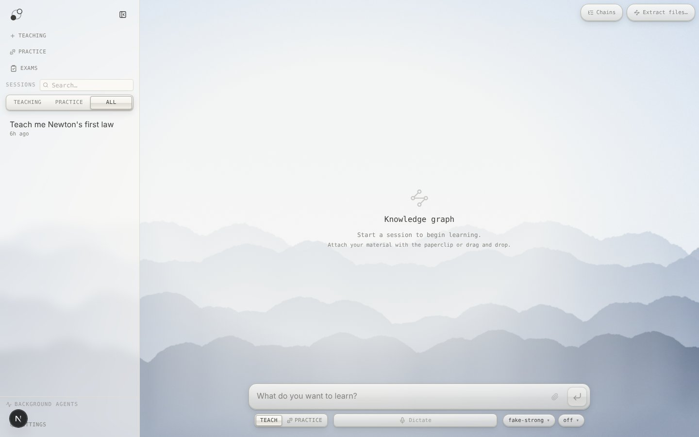
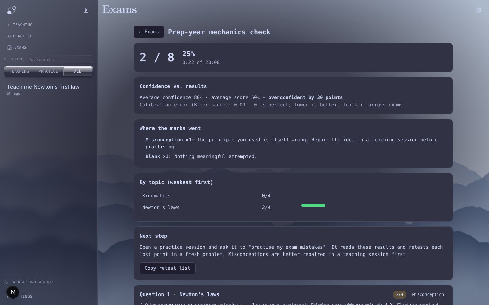
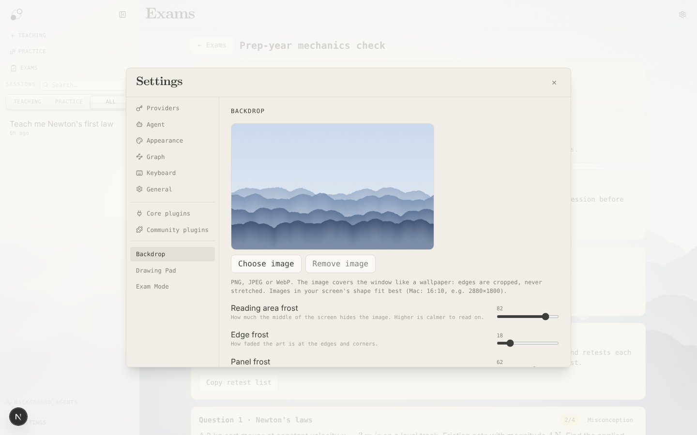

# Backdrop for LearnHarness

A [LearnHarness](https://github.com/amosblomqvist/learnharness) plugin that puts your own image behind the whole app.

The art stays vivid at the edges and corners. The reading area in the middle is frosted, so lessons and equations stay easy to read. The sidebar, input bar and chips become frosted glass, and an optional **chrome** style gives controls a bevelled metal-and-glass look.

It works with any color theme. The frost and the chrome are built from the active theme's own colors, so they look silver on light themes and gunmetal on dark ones.

## Install

The plugin needs no build step and no dependencies. The plugin folder **must be named `backdrop`**, because that's the ID in its manifest.

1. In LearnHarness, open **Settings → Community plugins** and copy the plugins directory path.
2. Download **backdrop.zip** from the [latest release](https://github.com/prinxipia/learnharness-backdrop/releases/latest) and extract it into the plugins directory. It already contains a correctly named `backdrop` folder.
   - **Or with git:** `git clone https://github.com/prinxipia/learnharness-backdrop "<plugins directory>/backdrop"`
3. Press refresh next to the path and enable **Backdrop**.
4. Open **Settings → Backdrop**, press **Choose image**, and pick a PNG, JPEG or WebP (up to 25 MB). The plugin keeps its own copy, so you can move or delete the original.

**Updating:** pull or replace the files, keep the `data/` folder (your image and settings live there), then restart LearnHarness.

## Settings

| Setting | What it does |
|---|---|
| Reading area frost | How much the middle of the screen hides the image. Raise it if a busy image competes with lesson text. |
| Edge frost | How faded the art is at the edges and corners. |
| Panel frost | How opaque the frosted glass is on the sidebar, input bar and chips. |
| Glass blur | How much the image is blurred behind the panels. |
| Keep visible when cropped | Which part of the image stays in view when the window's shape differs from the image's. |
| Chrome controls | The bevelled metal-and-glass control style. Turn it off for flat glass. |

Changes apply as you drag the sliders.

## Choosing an image

- **Fit:** the image covers the window like a desktop wallpaper. The edges are cropped, never stretched. An image in your screen's shape fits best: 16:10 for most Macs (for example 2880×1800), 16:9 for most other displays.
- **Composition:** keep the detail at the edges and corners and leave the middle calm. That's where lessons appear.

## Compatibility

- Requires LearnHarness **0.6.1** or later. Tested with 0.6.1 (browser mode), with light and dark themes.
- LearnHarness has no official background-image setting. This plugin styles parts of the app's own layout (the sidebar, input bar and chips), so a LearnHarness update can occasionally break part of the look. Disabling the plugin always restores the normal app.

## How it works

- **Frontend (`dist/main.js`):** adds a single stylesheet it owns. That stylesheet places your image on a fixed layer behind the app, adds a radial frost wash that's strongest in the middle, and frosts the sidebar, input bar and chips. Settings changes rewrite only that stylesheet.
- **Backend (`dist/backend.cjs`):** stores the image and settings in the plugin's `data/` folder, and checks that the image really is a PNG, JPEG or WebP.

Nothing leaves your machine. The plugin makes no network requests and no model calls.

## License

Public domain ([The Unlicense](LICENSE)). Do anything you like with it.
